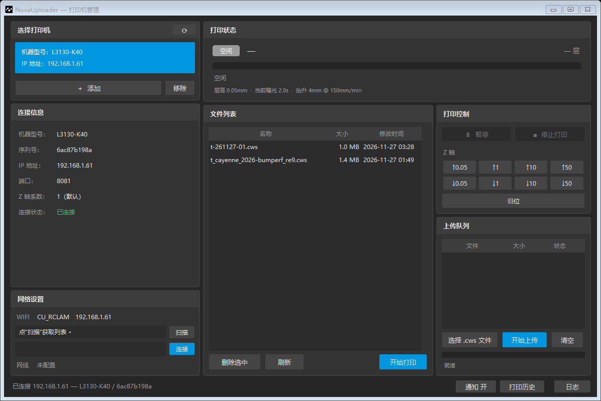

# NovaUploader

[简体中文](README.md) | **English**


A third-party management tool for Nova3D resin 3D printers. It talks straight to the HTTP API that the printer firmware exposes on port 8081 — no NovaMaker, no internet connection, no account.

The repo ships two clients that share the same printer API: the **Windows desktop app** (`pc/`, full feature set) and the **Android monitor** (`android/`, focused on status and quick control).

It exists because the official software froze on this machine the moment you hit Upload. The cause turned out not to be the network: after opening a native Windows file dialog, the process's Winsock is left uninitialised, so every subsequent request fails with `[Errno 10093]`. NovaMaker never recovers from that state — the only way out is killing the process. Since the whole API is plain HTTP anyway, writing a replacement was the simpler fix, and it could repair the Winsock problem along the way.



## Features

- **Upload** — multi-select `.cws` files, with live progress and speed. Measured: a 2 MB file takes 2.5 s (~0.79 MB/s, limited by the printer's Wi-Fi write speed); a 20 MB job takes about 25 s
- **Print status** — layer progress, elapsed and remaining time, current layer exposure, layer height, lift distance and speed. Bottom and normal layers switch automatically
- **Print control** — pause / resume, stop, Z-axis jog (0.05 / 1 / 10 / 50), and home. **Z-axis and home are locked automatically while a print is running**, so you can't crash the plate into a part that's forming
- **Print history** — grouped by printer serial number and kept permanently. Shows end time, duration, average layer time and layer height for each job. The printer itself only retains its 10 most recent jobs, so this is the only place long-term records survive
- **Network settings** — scan for Wi-Fi networks sorted by signal strength, connect, and check the wired NIC state. Useful when the printer's wireless link misbehaves and you switch it to Ethernet
- **Multiple printers** — keyed by serial number rather than IP, so records stay correct after a Wi-Fi or DHCP change
- **Completion notification** — a desktop toast plus a chime when a print finishes; completed and cancelled/stopped runs use different colours. Can be switched off from the status bar
- **Winsock self-repair** — `WSAStartup` is re-invoked right after file selection, with a `10093` detection-and-retry fallback in the network layer. This is the reason the project exists
- **UI** — dark card layout with colours sampled from NovaMaker itself (page `#323232`, card `#464646`, accent `#0097E0`); the rounded progress bar and buttons are drawn by hand

## Requirements

- Windows 10 / 11
- **No dependencies when using the prebuilt exe.** Running from source needs Python 3.9+ with tkinter (bundled in the official installer)

## Quick start

1. Download `NovaUploader.exe` from [Releases](https://github.com/Rechalliberalexmoll/nova-uploader/releases)
2. Run it, click **+ Add**, and enter the printer's IP
3. Select the printer to connect, then use **Select .cws file** to upload

Configuration and history are created under `%APPDATA%\NovaUploader\`, separate from the program directory — moving or renaming the exe won't lose them.

## Usage

- **Upload** — pick files, review the queue, hit **Start upload**. Filenames are passed through unchanged; a file with the same name is overwritten
- **Delete** — multi-select in the file list, then **Delete selected** (confirmation required)
- **Start printing** — select a file and press **Start print**; the printer begins immediately
- **Print control** — Z-axis and home are unavailable while printing; stopping a print cannot be undone and asks for confirmation
- **Print history** — **Print history** in the status bar; filter by printer, or read "last finished at …" straight off the banner

No registry writes, no services. Uninstall = delete the exe, then delete `%APPDATA%\NovaUploader\`.

## How it works

The Nova3D firmware exposes a set of HTTP endpoints on port `8081`. This tool uses only these:

| Purpose | Endpoint |
|:---|:---|
| Upload | `POST /file/upload/<name>`, body is the raw file bytes |
| File list | `GET /file/list` |
| Delete | `GET /file/delete/<name>` |
| Job status | `GET /job/list` |
| Pause / resume | `GET /job/toggle/<job-id>` |
| Stop | `GET /job/stop/<job-id>` |
| Start printing | `GET /file/print/<name>` |
| Z-axis move | `GET /printer/move/<distance>` |
| Home | `GET /printer/home` |
| Device info | `GET /setting/model`, `/setting/snsid`, `/setting/currentVersion` |
| Wi-Fi | `GET /setting/wifiList`, `/setting/wifiInfo`, `/setting/connectWifi/<ssid>/<password>/<security>` |

A few things learned the hard way:

**Uploads must send raw bytes, not multipart.** A 52-byte payload sent as `multipart/form-data` was stored as 270 bytes — the printer saved the entire request body as the file. With `Content-Type: application/octet-stream` and a raw body, a 2 MB file lands byte-for-byte identical to the source.

**The printer's web server is weak.** Some endpoints (`/job/getImg`, `/setting/ethInfo`) always return HTTP 500 and take a full 5 seconds to do it; `/printer/home` may not answer for ten seconds. Every request is therefore serialised and job polling runs on a 5-second interval, so the service is never hammered.

**Plain HTTP, bypassing the system proxy.** Requests go through `http.client` directly to the printer. Routing them through a system proxy sends LAN traffic off-box and breaks them.

**Privacy:** the tool only talks to the printer on your LAN. It makes no internet requests, writes no log files and reports nothing. Logs live in memory only and vanish when the window closes.

## About Z-axis movement

The `/printer/move/` parameter is in millimetres — measured travel matches the requested value on this machine (L3130-K40), so the jog buttons are labelled 0.05 / 1 / 10 / 50 mm with no conversion.

If a particular printer turns out to be noticeably off, add a `lift_scale` field to that printer in `printers.json` (factor = measured mm ÷ requested value, default `1.0`).

## Building from source

```powershell
cd pc
pip install pyinstaller
pyinstaller --noconfirm --onefile --windowed --name NovaUploader `
  --icon NovaUploader.ico NovaUploader.py
```

That produces a single exe of about 11 MB. To run from source instead, just `python pc\NovaUploader.py`.

## Repository layout

```
pc/                       Windows desktop app
  NovaUploader.py          single-file source (UI + printer API + logic)
  NovaUploader.ico         application icon (used at build time)
  启动 NovaUploader.vbs     launcher for the source version (pythonw, no console window)
android/                  Android monitor
  AndroidManifest.xml
  build.ps1                build script (aapt2 + javac + d8, no Gradle)
  novactl.keystore         signing key (keeps future versions upgradeable in place)
  res/                     resources and layouts
  src/                     Java sources
assets/main.png           desktop app screenshot
README.md / README.en.md
LICENSE
```

Both the exe and the apk ship through Releases and are not committed. `printers.json` / `history.json` contain printer IPs and serial numbers and are excluded via `.gitignore`.

## Android app

The phone talks straight to the printer — no PC in the middle, no vendor cloud. It is a subset of the desktop app, built around status and quick control:

- **Connection info** — model (code mapped to the product name) and serial number
- **Print status** — layer progress, elapsed / remaining time, layer height and exposure
- **Print control** — pause / resume, stop
- **Z axis** — four jog steps plus home, locked automatically while printing
- **File list** — pick a file already on the printer and start it (no upload)
- **Print history** — collapsed by default; expands to the printer's last 10 jobs

Verified on hardware (Nova3D L3130-K40, firmware 6.0.6): live status, pause / resume, stop, the four Z jog steps plus home, and starting a print from the file list.

Building needs JDK 17, Android build-tools 34 and platform 34. No Gradle:

```powershell
powershell -ExecutionPolicy Bypass -File android\build.ps1
```

The toolchain defaults to `D:\AndroidDev`; set `ANDROID_TOOLCHAIN` to point elsewhere. Output is `android\NovaCtl.apk` (about 61 KB).

On the phone, allow "unknown sources" and install. The signing key `novactl.keystore` is committed so later builds upgrade in place without losing data; if you plan to publish the app, swap it for your own key and keep it safe.

## Known limitations

- **Transition-layer exposure isn't handled separately.** The UI currently treats "first N layers = bottom, everything after = normal". The `chitubox.gcode` header inside a `.cws` does carry `transitionLayerCount`, and transition exposure decreases layer by layer — but that has to be parsed out of the file, which this tool doesn't do yet. During the transition window it reports the normal-layer exposure
- The firmware exposes no telemetry for motor load, Z limit switches or temperature, so hardware-level fault detection isn't possible. The official app can't get it either — it simply isn't there
- On some models `/job/getImg` always returns 500, so no job thumbnails
- `resinUsage` and `totalCost` are hard-coded to 0 by the firmware, so no consumption or cost tracking
- Only tested on a Nova3D L3130-K40 (firmware 6.0.6): upload, status, print control and Z-axis travel have all been verified on hardware. Other Nova3D models share the same API and should work
- The exe is unsigned, so SmartScreen may block it once on first run ("More info" → "Run anyway")

## Credits

- Nova3D / NovaMaker — for the printer firmware's HTTP API, and as the reference for the UI palette
- This project is unofficial and not affiliated with Nova

## License

MIT

Copyright (c) 2026 Rechalliberalexmoll
