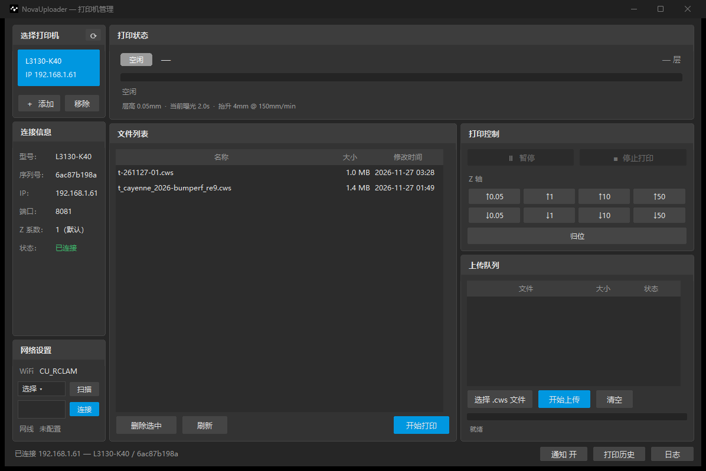

# NovaUploader

**简体中文** | [English](README.en.md)


Nova3D 树脂 3D 打印机的第三方管理工具。直接调用打印机固件自带的 HTTP 接口（8081 端口），不依赖官方 NovaMaker，也不需要联网或登录账号。

仓库同时包含两端，共用同一套打印机接口：**Windows 桌面版**（`pc/`，功能完整）与**安卓监控端**（`android/`，聚焦看状态与简单控制）。

起因是官方软件在这台机器上「一点上传就卡死」。查下去发现不是网络问题——是打开 Windows 原生文件对话框后，进程的 Winsock 会处于未初始化状态，之后所有网络请求都报 `[Errno 10093]`，而 NovaMaker 不会自愈，只能杀进程重启。既然接口都是公开的 HTTP，干脆自己写一个，顺手把这个坑也填了。



## 特性

- **上传**：多选 `.cws`，实时进度与速度。实测 2 MB 文件 2.5 秒（约 0.79 MB/s，受打印机 Wi-Fi 写入速度限制），20 MB 的件约 25 秒
- **打印状态**：层进度、已用与剩余时间、当前层曝光、层高、抬升距离与速度。底层与常规层自动切换显示
- **打印控制**：暂停 / 继续、停止、Z 轴升降（0.05 / 1 / 10 / 50 四档）、归位。**打印进行中会自动锁定 Z 轴与归位**，避免把正在成型的件顶坏
- **打印历史**：按打印机序列号分组，长期留存，可查看每次的结束时间、用时、平均层时、层厚。打印机自己只保留最近 10 条任务，这是唯一能长期留存记录的地方
- **网络设置**：扫描 WiFi 列表并按信号强度排序、连接、查看有线网卡状态。打印机无线出问题、改走网线直连时用得上
- **多打印机**：按序列号（而非 IP）区分，换 WiFi 或 DHCP 换地址后记录不会错乱
- **完成通知**：打印结束弹出桌面浮窗并播放提示音，成功与取消/停止用不同颜色区分，可在状态栏关闭
- **自动修 Winsock**：选完文件立刻重新调用 `WSAStartup`，网络层另有 `10093` 检测重试兜底——这是本项目存在的原因
- **界面**：深色卡片式布局，配色取自 NovaMaker 原版（页面 `#323232`、卡片 `#464646`、强调蓝 `#0097E0`），圆角进度条与按钮均为自绘

## 环境要求

- Windows 10 / 11
- **用预编译 exe 无需任何依赖**；从源码运行需要 Python 3.9 以上（含 tkinter，官方安装包默认自带）

## 快速开始

1. 从 [Releases](https://github.com/Rechalliberalexmoll/nova-uploader/releases) 下载 `NovaUploader.exe`
2. 双击运行，点「＋ 添加」，填入打印机 IP
3. 点选该打印机即可连接，之后直接用「选择 .cws 文件」上传

配置与历史会自动生成在 `%APPDATA%\NovaUploader\`，与程序目录分离，挪动或重命名 exe 都不会丢。

## 用法

- **上传**：选文件 → 队列 → 「开始上传」。文件名保持原样传给打印机，同名文件会被覆盖
- **删除**：文件列表里多选 → 「删除选中」，会二次确认
- **开始打印**：选中文件后点「开始打印」，打印机立即开始工作
- **打印控制**：Z 轴与归位在打印中不可用；停止打印不可恢复，会二次确认
- **打印历史**：底部状态栏「打印历史」，可按打印机筛选，也可在横幅上直接看到「上次 XX 结束」

不写注册表、不装服务。卸载 = 删掉 exe，再删 `%APPDATA%\NovaUploader\`。

## 工作原理

Nova3D 打印机固件在 `8081` 端口暴露一组 HTTP 接口，本工具只用到这些：

| 用途 | 接口 |
|:---|:---|
| 上传 | `POST /file/upload/<文件名>`，body 为文件原始字节 |
| 文件列表 | `GET /file/list` |
| 删除 | `GET /file/delete/<文件名>` |
| 任务状态 | `GET /job/list` |
| 暂停 / 继续 | `GET /job/toggle/<任务id>` |
| 停止 | `GET /job/stop/<任务id>` |
| 开始打印 | `GET /file/print/<文件名>` |
| Z 轴移动 | `GET /printer/move/<距离>` |
| 归位 | `GET /printer/home` |
| 设备信息 | `GET /setting/model`、`/setting/snsid`、`/setting/currentVersion` |
| WiFi | `GET /setting/wifiList`、`/setting/wifiInfo`、`/setting/connectWifi/<ssid>/<密码>/<security>` |

几个踩出来的细节：

**上传必须用原始字节，不能用 multipart。** 实测用 `multipart/form-data` 传 52 字节的内容，打印机存下来是 270 字节——把整个请求体当成文件存了。改成 `Content-Type: application/octet-stream` + 原始 body 后，2 MB 文件存入的字节数与源文件完全一致。

**打印机的 Web 服务很弱。** 部分接口（`/job/getImg`、`/setting/ethInfo`）固定返回 HTTP 500 且每次要等满 5 秒；`/printer/home` 可能十秒不回。所以所有请求串行化，任务轮询间隔 5 秒，避免把它的服务打满。

**HTTP 直连，不读系统代理。** 用 `http.client` 直连打印机，走系统代理会让局域网请求被转发出去而失败。

**隐私**：只与局域网内的打印机通信，不联网、不写日志文件、不上报任何数据。日志只存在内存里，窗口关掉即清空。

## 关于 Z 轴移动

`/printer/move/` 的参数就是毫米，实测移动量与请求值基本一致（本机 L3130-K40 上验证过），所以 Z 轴按钮直接标 0.05 / 1 / 10 / 50 mm，不做换算。

如果某台机器实测偏差明显，可以在 `printers.json` 里给该打印机加一个 `lift_scale` 字段（系数 = 实测毫米 ÷ 请求值，默认 `1.0`），用来校正。

## 从源码构建

```powershell
cd pc
pip install pyinstaller
pyinstaller --noconfirm --onefile --windowed --name NovaUploader `
  --icon NovaUploader.ico NovaUploader.py
```

产出单个 exe（约 11 MB）。直接运行源码则只需 `python pc\NovaUploader.py`。

## 仓库结构

```
pc/                        Windows 桌面版
  NovaUploader.py          单文件源码（界面 + 打印机接口 + 逻辑）
  NovaUploader.ico         应用图标（构建用）
  启动 NovaUploader.vbs     源码版启动器（用 pythonw 运行，不弹黑框）
android/                   安卓监控端
  AndroidManifest.xml
  build.ps1                构建脚本（aapt2 + javac + d8，不使用 Gradle）
  novactl.keystore         签名密钥（保证后续版本可覆盖安装）
  res/                     资源与布局
  src/                     Java 源码
assets/main.png            桌面版界面截图
README.md / README.en.md
LICENSE
```

exe 与 apk 均走 Release，不入库；`printers.json` / `history.json` 含打印机 IP 与序列号，已在 `.gitignore` 中排除。

## 安卓端

手机直连打印机，不经过电脑，也不经过厂商云端。功能是桌面版的子集，聚焦「看状态 + 简单控制」：

- **连接信息**：机型（型号代码映射为商品名）与序列号
- **打印状态**：层进度、已用与剩余时间、层高与曝光参数
- **打印控制**：暂停 / 继续、停止
- **Z 轴**：四档升降 + 归位，打印中自动锁定
- **文件列表**：点选打印机上的文件直接起印（不做上传）
- **打印历史**：默认折叠，展开显示打印机上最近 10 条任务

已在 Nova3D L3130-K40（固件 6.0.6）上实机验证：状态刷新、暂停/继续、停止、Z 轴四档升降与归位、从文件列表起印均正常。

构建需要 JDK 17、Android build-tools 34 与 platform 34，不使用 Gradle：

```powershell
powershell -ExecutionPolicy Bypass -File android\build.ps1
```

工具链默认放在 `D:\AndroidDev`，可用环境变量 `ANDROID_TOOLCHAIN` 指向其他位置。产物为 `android\NovaCtl.apk`（约 61 KB）。

安装时允许「未知来源」即可。签名密钥 `novactl.keystore` 已入库，目的是保证后续版本能覆盖安装、不丢数据；若要公开发布，建议换成自己的密钥并妥善保管。

## 已知限制

- **过渡层曝光没有单独处理**：当前按「前 N 层底层、之后常规」两段显示。`.cws` 里的 `chitubox.gcode` 头部其实带 `transitionLayerCount`，过渡层曝光是逐层递减的，读数只能从文件里解析——本工具尚未做，所以过渡层区间显示的是常规层曝光
- 固件不提供电机负载、Z 限位、温度等遥测，无法做硬件级异常检测。官方 App 同样拿不到，是固件层面就没有
- 部分机型的 `/job/getImg` 固定返回 500，无法显示任务缩略图
- `resinUsage` / `totalCost` 两个字段固件恒返回 0，不做用量与成本统计
- 已测试机型仅 Nova3D L3130-K40（固件 6.0.6）：上传、状态、打印控制、Z 轴移动量均已实机验证；其他 Nova3D 机型共用同一套接口，理论上通用
- exe 未做代码签名，他人首次运行可能被 SmartScreen 拦一次（「更多信息」→「仍要运行」）

## 致谢

- Nova3D / NovaMaker — 打印机固件的 HTTP 接口，以及界面配色的参考来源
- 本工具与 Nova 官方无关，属第三方工具

## License

MIT

Copyright (c) 2026 Rechalliberalexmoll
